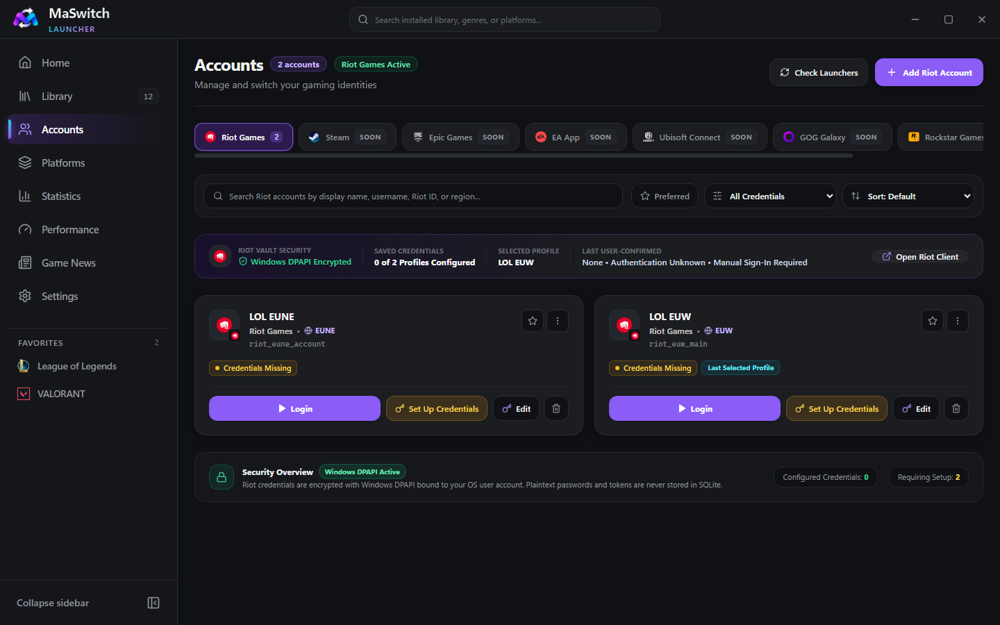
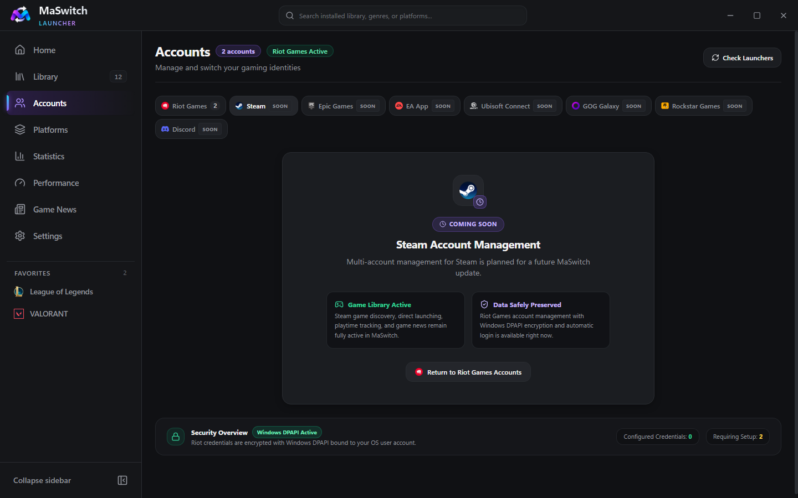
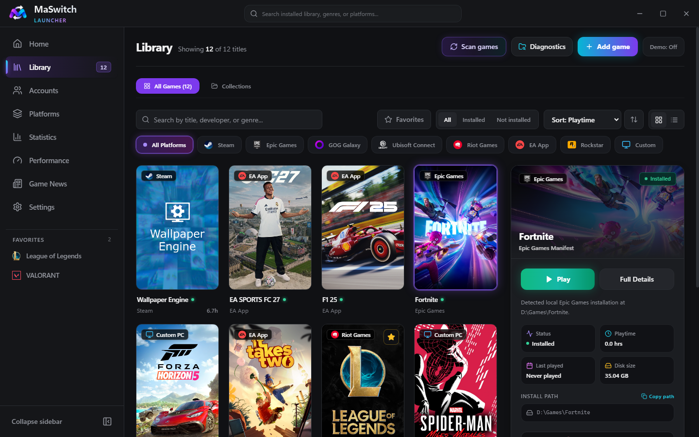
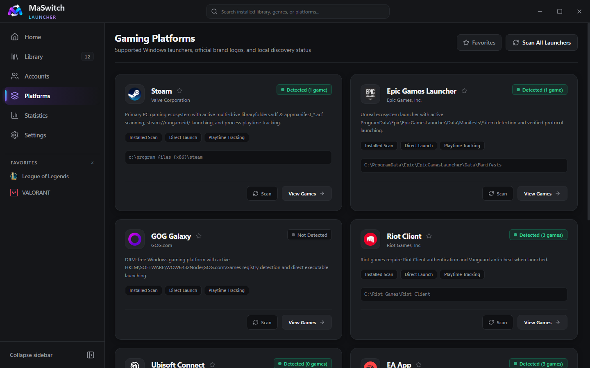
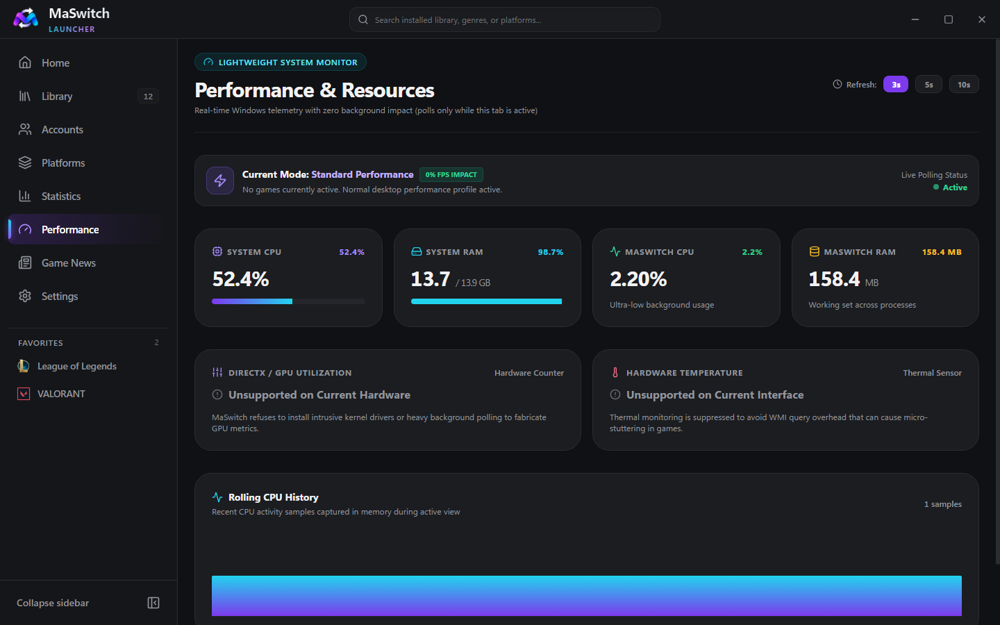
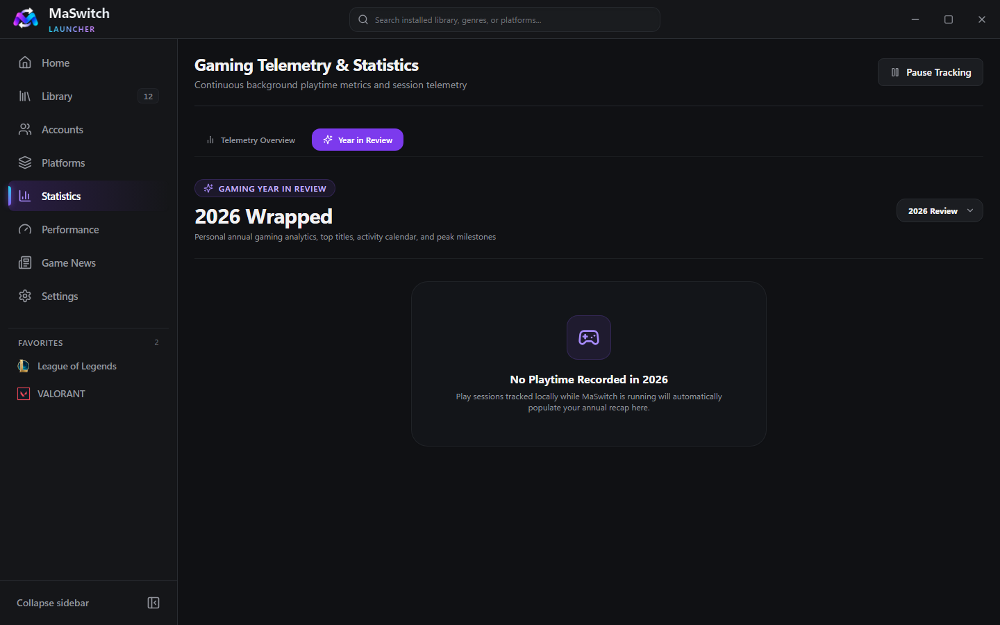

<div align="center">
  

  # MaSwitch

  **Lightweight Windows Gaming Launcher & Account Manager**

  **Official website: [maswitch.martinx.work](https://maswitch.martinx.work/)**

  [](https://maswitch.martinx.work/)
  [](https://github.com/martinwassimx/MaSwitch/releases/tag/v1.1.0)
  [-0ea5e9?style=for-the-badge)](https://github.com/martinwassimx/MaSwitch/releases/tag/v1.1.0)
  [](LICENSE)

  [**Download Latest Windows Installer (`MaSwitch-Setup-1.1.0.exe`)**](https://github.com/martinwassimx/MaSwitch/releases/tag/v1.1.0) · [Website](https://maswitch.martinx.work/) · [FAQ](https://maswitch.martinx.work/faq) · [Report Issue](https://github.com/martinwassimx/MaSwitch/issues) · [Security Policy](SECURITY.md) · [Changelog](CHANGELOG.md)
</div>

---

## About MaSwitch

**MaSwitch** is a fast, privacy-focused Windows desktop gaming launcher and account manager engineered to run smoothly on both low-end and high-end gaming PCs. It unifies your installed PC games into a single library, automates **Riot Games** account switching using Windows DPAPI encryption and official Windows UI Automation, tracks accurate game playtime with application exclusions, and provides optional lightweight gaming utilities through a modular Windows installer.

---

## Key Features

### 1. Riot Games Account Management & Automatic Login
- **Multi-Account Identity Cards**: Organize multiple Riot Games accounts (`League of Legends`, `VALORANT`, `Teamfight Tactics`) with display names, Riot IDs, regions (`EUW`, `NA`, `EUNE`, `KR`, etc.), and preferred-account stars.
- **Windows DPAPI Encrypted Vault**: Credentials are encrypted locally on your machine using the native Windows Data Protection API (`CryptProtectData` / Electron `safeStorage`) bound to your Windows user login.
- **Official Riot Client UI Automation**: Launches or focuses the official Riot Client, automatically waits for the login window to initialize, fills your credentials without using the Windows clipboard, optionally presses the Sign In button, and hands off cleanly for 2FA/MFA or CAPTCHA verification.

### 2. Unified Multi-Platform Game Library
- **Automatic Installed Game Discovery**: Scans local manifests and registry entries for **Steam**, **Epic Games**, **EA App**, **Ubisoft Connect**, **GOG Galaxy**, **Riot Games**, **Rockstar Games Launcher**, and **Custom PC Games**.
- **Official Launcher Protocol Routing**: Launches Steam (`steam://rungameid/<id>`) and Epic Games (`com.epicgames.launcher://apps/<AppName>?action=launch&silent=true`) titles—including Fortnite—through their official launchers without modifying game binaries or anti-cheat files.
- **Custom Artwork & SteamGridDB Integration**: Customize game covers, hero banners, logos, and icons with local disk caching.

### 3. Accurate Playtime Tracking & Exclusions
- **Lightweight Process Tracking**: Tracks real active gaming sessions (`Starting` → `Running` → `Completed`) with automatic Windows Sleep/Resume handling and crash recovery.
- **Built-In Application Exclusions**: Automatically excludes background utilities such as **Wallpaper Engine** (`wallpaper64.exe`, `wallpaper32.exe`) and idle launcher processes so your playtime statistics remain accurate.

### 4. Modular Optional Features (Selectable During Setup)
Users on low-end PCs can choose **Minimal**, **Recommended**, **Complete**, or **Custom** presets during installation to install only the features they want:
1. **Gaming Year in Review**: Personalized annual gaming summary, top played titles, platform breakdown, and shareable summary card export.
2. **Smart Game Collections**: Dynamic rule-based collections (`Most Played`, `Recently Played`, `Unplayed Backlog`, `Riot Competitive`) and custom manual collections.
3. **Lightweight Performance Monitor**: On-demand CPU, system RAM, and MaSwitch memory footprint telemetry with zero background polling when closed.
4. **Game Updates & News**: Personalized multi-platform game news and patch notes across **Riot Games** (`League of Legends`, `VALORANT`, `Teamfight Tactics`), **Epic Games** (`Fortnite`), **EA Sports** (`EA SPORTS FC`), **Steam**, **Ubisoft**, **Rockstar**, and supported PC games, with automatic utility exclusion (`Wallpaper Engine`), per-game provider coverage diagnostics, and offline caching.
5. **Backup & Restore**: Versioned local backup archives for profiles, collections, settings, and playtime history (strictly excluding DPAPI vault secrets).
6. **Memory Management (Mem Reduct Integration)**: Safe Windows NT memory list cleaning (`Working Sets`, `System File Cache`, `Standby List`, `Modified Page List`) inspired by the open-source [Mem Reduct](https://github.com/henrypp/memreduct) project—never closes user applications and automatically locks while a game is running.

---

## Screenshots

| Riot Games Account Management | Multi-Platform Coming Soon View |
| :---: | :---: |
|  |  |

| Unified Game Library & Details | Platforms & Detection |
| :---: | :---: |
|  |  |

| Performance & Memory Management | Gaming Year in Review |
| :---: | :---: |
|  |  |

---

## Coming Soon

Account management is currently active exclusively for **Riot Games**. Multi-account management for the following platforms is marked **Coming Soon** in the Accounts tab and planned for future updates:
- **Steam Account Management** *(Game library discovery, launching & playtime tracking are already active)*
- **Epic Games Account Management** *(Game library discovery, launching & playtime tracking are already active)*
- **EA App Account Management** *(Game library discovery, launching & playtime tracking are already active)*
- **Ubisoft Connect Account Management** *(Game library discovery, launching & playtime tracking are already active)*
- **GOG Galaxy Account Management** *(Game library discovery, launching & playtime tracking are already active)*
- **Rockstar Games Account Management** *(Game library discovery, launching & playtime tracking are already active)*
- **Discord Identity Integration**

---

## System Requirements & Supported Windows Versions

| Requirement | Minimum Specification | Recommended Specification |
| :--- | :--- | :--- |
| **Operating System** | Windows 10 (64-bit, version 1903+) | Windows 10 / Windows 11 (64-bit) |
| **Processor (CPU)** | Dual-core x64 processor | Quad-core x64 processor |
| **Memory (RAM)** | 4 GB RAM (Low-End PC Mode supported) | 8 GB+ RAM |
| **Disk Space** | ~200 MB free space | 500 MB free space (with artwork cache) |

---

## Installation

1. Go to the [**MaSwitch download page**](https://maswitch.martinx.work/download) or the [**Latest GitHub Release (`v1.1.0`)**](https://github.com/martinwassimx/MaSwitch/releases/tag/v1.1.0).
2. Download **`MaSwitch-Setup-1.1.0.exe`** (and optionally `SHA256SUMS.txt` to verify file integrity).
3. Run **`MaSwitch-Setup-1.1.0.exe`**.
4. Choose your preferred setup preset (**Minimal**, **Recommended**, **Complete**, or **Custom**).
5. Complete installation and launch **MaSwitch** from your Desktop or Start Menu.

> **Note on Windows SmartScreen**: Because this open-source release is built without a commercial EV/OV Authenticode certificate, Windows Defender SmartScreen may display an *"Unknown Publisher"* prompt on first download. You can verify the installer's SHA-256 hash against `SHA256SUMS.txt` before running:
> ```powershell
> Get-FileHash -Algorithm SHA256 .\MaSwitch-Setup-1.1.0.exe
> ```

---

## Privacy & Security Architecture

- **100% Local Storage**: All game library records, playtime sessions, and settings are stored locally in `%APPDATA%\maswitch`. No cloud account is required, and no telemetry is transmitted.
- **Windows DPAPI Credential Vault**: Riot Games passwords are encrypted using Windows DPAPI (`CryptProtectData`) tied to your Windows user profile. Plaintext passwords are never stored in SQLite, logs, or backups.
- **Official Launcher Integrity**: MaSwitch never injects DLLs, never modifies game executables, and never tampers with anti-cheat services (`Riot Vanguard`, `EasyAntiCheat`, `BattlEye`).
- **Hardened Electron Sandbox**: Runs with `sandbox: true`, `contextIsolation: true`, `nodeIntegration: false`, strict CSP headers, and `asInvoker` standard user privileges.

See [SECURITY.md](SECURITY.md) and the [Privacy & Security policy](https://maswitch.martinx.work/privacy) for full technical details.

---

## Help & Support

- **Website**: [maswitch.martinx.work](https://maswitch.martinx.work/)
- **FAQ**: [maswitch.martinx.work/faq](https://maswitch.martinx.work/faq)
- **Bug reports & feature requests**: [GitHub Issues](https://github.com/martinwassimx/MaSwitch/issues)
- **Security vulnerabilities**: see [SECURITY.md](SECURITY.md)

---

## Development Instructions

### Prerequisites
- Windows 10 or Windows 11 (x64)
- Node.js 20+ and npm 10+

### Clone & Run Locally
```powershell
# Clone repository
git clone https://github.com/martinwassimx/MaSwitch.git
cd MaSwitch

# Install dependencies
npm install

# Run in development mode
npm run dev
```

### Build & Test Commands
```powershell
# Run TypeScript typecheck
npm run typecheck

# Run ESLint
npm run lint

# Run full Vitest automated test suite
npm run test

# Build unpacked Windows application and modular NSIS installer
npm run dist:dir
npm run dist:installer

# Generate SHA-256 checksums and verify release artifacts
npm run verify:release
```

---

## License

MaSwitch is released under the [**MIT License**](LICENSE).  
Copyright © 2026 **Martin Wassim** ([martinx.work](https://martinx.work)).

See [LICENSE](LICENSE) for full license terms and third-party attributions (including architectural attribution to [Mem Reduct](https://github.com/henrypp/memreduct) by Henry++).
